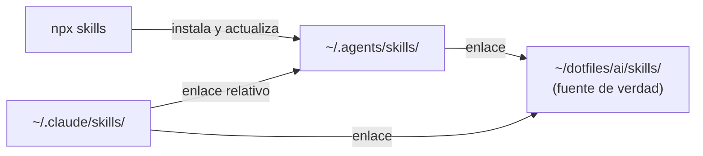

<div align="center">

# Dotfiles

[English](README.md) | **Español**

_Una fuente de verdad para los skills de mis agentes de IA en macOS._


[Características](#características) • [Estructura](#estructura) • [Skills](#skills-personalizados) • [En proyectos](#usar-los-skills-en-proyectos) • [Crear un skill](#crear-un-skill-nuevo) • [Uso](#uso) • [Problemas](#solución-de-problemas) • [Recuperación](#respaldos-y-recuperación)

</div>

Este repositorio guarda mis **skills personalizados** y dos scripts para auditar y sincronizar los skills que comparten agentes como Claude Code y Codex, sin duplicar archivos.

## Características

- **Una sola copia por skill:** los agentes la consumen mediante enlaces simbólicos.
- **Auditoría de duplicados:** detecta directorios idénticos o divergentes entre agentes.
- **Sincronización segura:** modo simulación por defecto, respaldos fechados y sin sobrescribir rutas existentes.
- **Skills de estructura de proyectos:** convenciones para Angular, Hono, NestJS y React + Vite + shadcn/ui.

> [!NOTE]
> Este README cubre solo la organización de skills y los scripts incluidos. El repositorio no automatiza la instalación del sistema, la terminal ni otras herramientas.

## Estructura

```text
~/dotfiles/
├── ai/
│   └── skills/                 # Skills personalizados (versionados)
│       ├── angular-project-structure/
│       ├── dependabot-setup/
│       ├── hono-project-structure/
│       ├── nestjs-project-structure/
│       ├── playwright-cli/
│       ├── react-vite-shadcn-project-structure/
│       └── unit-testing-expert/
├── scripts/
│   ├── audit-skills.sh         # Detecta duplicados entre agentes y plugins
│   └── sync-skills.sh          # Deduplica y crea enlaces simbólicos
└── backups/
    └── skills/                 # Respaldos de deduplicación (ignorados por Git)
```

Cada skill vive en su propio directorio con un `SKILL.md` y, según el caso, recursos adicionales:

- `references/`: documentación de apoyo que el agente carga bajo demanda.
- `agents/openai.yaml`: metadatos para Codex.
- `assets/icon.svg`: ícono del skill.

### Cómo se comparten los skills

| Ubicación | Responsabilidad |
| --- | --- |
| `~/dotfiles/ai/skills/` | Fuente de verdad de los skills personalizados. |
| `~/.agents/skills/` | Skills globales administrados por `npx skills` y enlaces a los personalizados. |
| `~/.claude/skills/` | Skills exclusivos de Claude Code y enlaces a skills globales o personalizados. |
| `~/dotfiles/backups/skills/` | Copias creadas durante la deduplicación. |



Los enlaces simbólicos permiten que todos los agentes usen una única copia:

```text
~/.agents/skills/hono-project-structure  -> ~/dotfiles/ai/skills/hono-project-structure
~/.claude/skills/hono-project-structure  -> ~/dotfiles/ai/skills/hono-project-structure
~/.claude/skills/branch-pr               -> ../../.agents/skills/branch-pr
```

## Skills personalizados

| Skill | Propósito |
| --- | --- |
| [`angular-project-structure`](ai/skills/angular-project-structure/SKILL.md) | Estructura Angular por funcionalidades, con límites `ui`, `data-access` y `utils`. |
| [`dependabot-setup`](ai/skills/dependabot-setup/SKILL.md) | Instala, audita y repara Dependabot en un repo: `dependabot.yml`, agrupación, cooldown, conflictos de lockfile y orden de merge de PRs. |
| [`hono-project-structure`](ai/skills/hono-project-structure/SKILL.md) | Ubicación de archivos en apps Hono para Workers, Node.js, Bun y Deno. |
| [`nestjs-project-structure`](ai/skills/nestjs-project-structure/SKILL.md) | Organización por funcionalidades de módulos, controladores, servicios y DTOs en NestJS. |
| [`playwright-cli`](ai/skills/playwright-cli/SKILL.md) | Automatización de navegador y pruebas con Playwright CLI. |
| [`react-vite-shadcn-project-structure`](ai/skills/react-vite-shadcn-project-structure/SKILL.md) | Organización de apps React + Vite + TypeScript con shadcn/ui. |
| [`unit-testing-expert`](ai/skills/unit-testing-expert/SKILL.md) | Tests con Vitest/Jest + Testing Library bajo reglas estrictas: AAA, aserciones mínimas y comportamiento visible al usuario. |

## Usar los skills en proyectos

Después de sincronizar, los skills están disponibles en **todos tus proyectos** sin configuración adicional: Claude Code los lee de `~/.claude/skills/` y Codex de `~/.agents/skills/`.

### Activación automática

El agente carga un skill cuando tu petición coincide con su `description`. Basta con trabajar con normalidad dentro del proyecto:

```text
> Crea la feature de facturación con su listado y formulario        # React + Vite + shadcn
> ¿Dónde pongo el middleware de autenticación de esta app Hono?     # Hono
> Agrega un módulo de usuarios con controlador, servicio y DTOs     # NestJS
> Abre localhost:5173 y prueba el flujo de login                    # Playwright CLI
```

### Invocación explícita

Para forzar un skill concreto:

| Agente | Sintaxis |
| --- | --- |
| Claude Code | `/react-vite-shadcn-project-structure` |
| Codex | `$react-vite-shadcn-project-structure` (usa `/skills` para listarlos) |

Puedes añadir instrucciones después del nombre, por ejemplo: `/angular-project-structure revisa la carpeta src/app/orders`.

### Skills solo para un proyecto

Para que un skill aplique únicamente a un repositorio, o para compartirlo con tu equipo, cópialo dentro del proyecto:

```bash
# Claude Code
mkdir -p .claude/skills
cp -R ~/dotfiles/ai/skills/hono-project-structure .claude/skills/

# Codex
mkdir -p .agents/skills
cp -R ~/dotfiles/ai/skills/hono-project-structure .agents/skills/
```

> [!TIP]
> Copia en lugar de enlazar cuando el repositorio se comparte: un enlace a `~/dotfiles` solo funciona en tu equipo. A cambio, la copia no recibe las actualizaciones de `ai/skills/`.

## Crear un skill nuevo

Un skill creado en `ai/skills/` llega a Claude Code, Codex y OpenCode con solo enlazarlo en dos carpetas:

| Agente | Carpetas globales que lee |
| --- | --- |
| Claude Code | `~/.claude/skills/` |
| Codex | `~/.agents/skills/` (y la obsoleta `~/.codex/skills/`) |
| OpenCode | `~/.config/opencode/skills/`, `~/.claude/skills/` y `~/.agents/skills/` |

1. Crea el directorio y su `SKILL.md`:

   ```bash
   mkdir -p ~/dotfiles/ai/skills/mi-skill
   ```

   ```markdown
   ---
   name: mi-skill
   description: Qué hace y cuándo usarlo. De esto depende la activación automática.
   ---

   # Mi skill

   Instrucciones para el agente...
   ```

   El `name` debe coincidir con el nombre del directorio.

2. Crea los enlaces en `~/.agents/skills/` y `~/.claude/skills/`:

   ```bash
   bash ~/dotfiles/scripts/sync-skills.sh --dry-run
   bash ~/dotfiles/scripts/sync-skills.sh --apply
   ```

3. Úsalo:

   | Agente | Invocación |
   | --- | --- |
   | Claude Code | `/mi-skill` o automática por `description` |
   | Codex | `$mi-skill` o automática por `description` |
   | OpenCode | Automática mediante su herramienta `skill` |

Las ediciones posteriores en `ai/skills/mi-skill/` se reflejan en todos los agentes sin volver a sincronizar.

> [!NOTE]
> OpenCode descubre el skill en `~/.claude/skills/` y en `~/.agents/skills/`. Ambas rutas apuntan a la misma copia; si aparece duplicado, revisa cómo resuelve los nombres repetidos.

## Uso

### Auditar duplicados

```bash
bash ~/dotfiles/scripts/audit-skills.sh
```

Compara los directorios reales (no enlaces) que existen con el mismo nombre en `~/.agents/skills/` y `~/.claude/skills/`:

- `IDENTICAL`: el contenido coincide y puede deduplicarse.
- `DIFFERENT`: el contenido difiere y requiere revisión manual.
- `ERROR`: `diff` no pudo compararlos (por ejemplo, un archivo sin permiso de lectura); su mensaje se muestra arriba.

También compara cada directorio real de `~/.codex/skills/` (la carpeta obsoleta que Codex aún lee) con el mismo skill en `~/.agents/skills/` o, si no existe, en `~/.claude/skills/`. Esos resultados llevan el prefijo `codex/`. `sync-skills.sh` no gestiona esta carpeta: sustituye la copia duplicada por un enlace a mano. Mueve antes la copia; si no, `ln -s` crea el enlace dentro del directorio existente:

```bash
mkdir -p ~/dotfiles/backups/skills/codex-manual
mv ~/.codex/skills/<nombre-skill> ~/dotfiles/backups/skills/codex-manual/
ln -s ../../.claude/skills/<nombre-skill> ~/.codex/skills/<nombre-skill>
```

> [!NOTE]
> `_shared` y `codex/_shared` aparecen como `DIFFERENT` de forma esperada: su contenido difiere entre agentes. `sync-skills.sh` ignora cualquier directorio que empiece con `_`.

La sección `Plugin Skills Audit` revisa los plugins de Claude Code habilitados en `~/.claude/settings.json`. Si un skill del plugin tiene el mismo nombre que una entrada de `~/.claude/skills/` (enlace o directorio), lo reporta como `PLUGIN-DUP`: Claude lo cargaría dos veces (por ejemplo, `wrangler` y `cloudflare:wrangler`). `~/.agents/skills/` no cuenta, porque Claude Code no lo lee.

Para resolverlo, borra el enlace de `~/.claude/skills/` y conserva el plugin; Codex y OpenCode siguen leyendo `~/.agents/skills/`:

```bash
rm ~/.claude/skills/<nombre-skill>
rm ~/.codex/skills/<nombre-skill>   # si apuntaba a ~/.claude/skills y quedó roto
```

> [!TIP]
> Un paquete de skills debe tener una sola fuente por agente. Si trae MCP, hooks o comandos, instala el plugin en Claude. Si solo trae skills y varios agentes los usan, instálalos con `npx skills` en `~/.agents/skills/`. Los skills propios van en `ai/skills/`.

### Sincronizar

Simular primero (es el modo por defecto si no se pasa argumento):

```bash
bash ~/dotfiles/scripts/sync-skills.sh --dry-run
```

Aplicar los cambios:

```bash
bash ~/dotfiles/scripts/sync-skills.sh --apply
```

El script:

1. Detecta directorios idénticos entre `~/.agents/skills/` y `~/.claude/skills/`.
2. Mueve la copia de Claude a `~/dotfiles/backups/skills/<fecha-hora>/claude/`.
3. La reemplaza por un enlace relativo al directorio global.
4. Crea los enlaces que falten desde `~/.agents/skills/` y `~/.claude/skills/` hacia `~/dotfiles/ai/skills/`.
5. Omite directorios con contenido distinto y rutas que ya existen, incluidos enlaces rotos.

> [!IMPORTANT]
> Revisa siempre la salida de `--dry-run` antes de `--apply`. El script no descarga skills ni resuelve conflictos de contenido.

> [!WARNING]
> Los enlaces a skills personalizados son absolutos (`$HOME/dotfiles/...`). Si restauras los dotfiles en otra ruta, tendrás que recrearlos.

### Actualizar skills externos

```bash
npx skills@latest update
npx skills@latest list -g
```

Solo actualiza los skills que administra `skills` (por ejemplo, los instalados desde `mattpocock/skills` o `vercel-labs/skills`). No toca directorios copiados manualmente.

### Actualizar los dotfiles

```bash
git -C ~/dotfiles pull --ff-only
```

Los cambios en `ai/skills/` llegan de inmediato a los agentes a través de los enlaces.

## Solución de problemas

### Un agente no encuentra un skill

Revisa a dónde apunta el enlace:

```bash
realpath ~/.claude/skills/branch-pr
realpath ~/.agents/skills/hono-project-structure
```

Si la ruta no existe, el enlace está roto. Para listar todos los enlaces rotos:

```bash
find ~/.agents/skills ~/.claude/skills -type l ! -exec test -e {} \; -print
```

`sync-skills.sh` no reemplaza enlaces rotos: elimina el enlace manualmente y vuelve a ejecutar la sincronización.

### La auditoría sigue mostrando `DIFFERENT`

El script nunca consolida contenido distinto. Compara ambas copias con `diff -r`, decide cuál conservar y deja la otra como enlace. Lo esperado tras sincronizar es que solo queden `DIFFERENT _shared` y `DIFFERENT codex/_shared`.

## Respaldos y recuperación

Los respaldos se guardan en:

```text
~/dotfiles/backups/skills/<fecha-hora>/claude/<nombre-del-skill>/
```

Para restaurar un skill de Claude:

1. Confirma que el respaldo existe y contiene los archivos esperados.
2. Elimina **solo el enlace** en `~/.claude/skills/<nombre-del-skill>` (nunca su destino).
3. Mueve la copia respaldada a `~/.claude/skills/<nombre-del-skill>/`.
4. Ejecuta la auditoría de nuevo.

> [!CAUTION]
> No borres en bloque `~/.agents/skills/` ni `~/.claude/skills/`: algunos directorios son fuentes reales y otros son enlaces.

## Convenciones

- **Skills propios:** se editan y versionan solo en `~/dotfiles/ai/skills/`.
- **Skills externos:** conservan sus rutas y se actualizan con `npx skills@latest update`.
- **Skills exclusivos de Claude:** permanecen en `~/.claude/skills/` hasta que haya razón para compartirlos.
- **Duplicados:** se comparan antes de consolidar; nunca se reemplaza contenido distinto automáticamente.
- **Respaldos:** fuera del control de versiones (`backups` está en `.gitignore`).
- **Enlaces:** se validan después de cada migración o restauración.

## Próximas mejoras

- Diagnóstico de enlaces rotos y `SKILL.md` faltantes.
- Enlaces relativos para los skills personalizados.
- Instalación reproducible de skills externos desde un manifiesto.
- Auditoría automática tras cada actualización.
