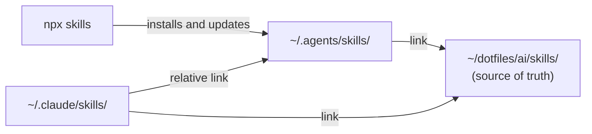

<div align="center">

# Dotfiles

**English** | [Español](README.es.md)

_A single source of truth for my AI agent skills on macOS._


[Features](#features) • [Structure](#structure) • [Skills](#custom-skills) • [In projects](#using-skills-in-projects) • [New skill](#creating-a-new-skill) • [Usage](#usage) • [Troubleshooting](#troubleshooting) • [Recovery](#backups-and-recovery)

</div>

This repository holds my **custom skills** and two scripts to audit and synchronize the skills shared by agents such as Claude Code and Codex, without duplicating files.

## Features

- **One copy per skill:** agents consume it through symbolic links.
- **Duplicate audit:** detects identical or diverging directories across agents.
- **Safe synchronization:** dry run by default, timestamped backups, and existing paths are never overwritten.
- **Project structure skills:** conventions for Angular, Hono, NestJS, and React + Vite + shadcn/ui.

> [!NOTE]
> This README only covers skill organization and the included scripts. The repository does not automate system, terminal, or other tool installation.

## Structure

```text
~/dotfiles/
├── ai/
│   └── skills/                 # Custom skills (versioned)
│       ├── angular-project-structure/
│       ├── dependabot-setup/
│       ├── hono-project-structure/
│       ├── nestjs-project-structure/
│       ├── playwright-cli/
│       ├── react-vite-shadcn-project-structure/
│       ├── typescript-documentation/
│       └── unit-testing-expert/
├── scripts/
│   ├── audit-skills.sh         # Detects duplicates across agents and plugins
│   └── sync-skills.sh          # Deduplicates and creates symlinks
└── backups/
    └── skills/                 # Deduplication backups (ignored by Git)
```

Each skill lives in its own directory with a `SKILL.md` and, when needed, extra resources:

- `references/`: supporting docs the agent loads on demand.
- `agents/openai.yaml`: metadata for Codex.
- `assets/icon.svg`: skill icon.

### How skills are shared

| Location | Responsibility |
| --- | --- |
| `~/dotfiles/ai/skills/` | Source of truth for custom skills. |
| `~/.agents/skills/` | Global skills managed by `npx skills`, plus links to custom skills. |
| `~/.claude/skills/` | Claude Code-only skills, plus links to global or custom skills. |
| `~/dotfiles/backups/skills/` | Copies created during deduplication. |



Symbolic links let every agent use a single copy:

```text
~/.agents/skills/hono-project-structure  -> ~/dotfiles/ai/skills/hono-project-structure
~/.claude/skills/hono-project-structure  -> ~/dotfiles/ai/skills/hono-project-structure
~/.claude/skills/branch-pr               -> ../../.agents/skills/branch-pr
```

## Custom skills

| Skill | Purpose |
| --- | --- |
| [`angular-project-structure`](ai/skills/angular-project-structure/SKILL.md) | Feature-first Angular structure with `ui`, `data-access`, and `utils` boundaries. |
| [`dependabot-setup`](ai/skills/dependabot-setup/SKILL.md) | Install, audit, and fix Dependabot in a repo: `dependabot.yml`, grouping, cooldown, lockfile conflicts, and PR merge order. |
| [`hono-project-structure`](ai/skills/hono-project-structure/SKILL.md) | File placement for Hono apps on Workers, Node.js, Bun, and Deno. |
| [`nestjs-project-structure`](ai/skills/nestjs-project-structure/SKILL.md) | Feature-first organization of NestJS modules, controllers, services, and DTOs. |
| [`playwright-cli`](ai/skills/playwright-cli/SKILL.md) | Browser automation and testing with Playwright CLI. |
| [`react-vite-shadcn-project-structure`](ai/skills/react-vite-shadcn-project-structure/SKILL.md) | Organization of React + Vite + TypeScript apps with shadcn/ui. |
| [`typescript-documentation`](ai/skills/typescript-documentation/SKILL.md) | Concise, accurate English TSDoc/JSDoc comments for TypeScript functions, classes, types, and public APIs. |
| [`unit-testing-expert`](ai/skills/unit-testing-expert/SKILL.md) | Vitest/Jest + Testing Library tests with strict rules: AAA, minimal assertions, user-facing behavior. |

## Using skills in projects

After synchronizing, skills are available in **all your projects** with no extra setup: Claude Code reads them from `~/.claude/skills/` and Codex from `~/.agents/skills/`.

### Automatic activation

The agent loads a skill when your request matches its `description`. Just work normally inside the project:

```text
> Create the billing feature with its list and form                 # React + Vite + shadcn
> Where should the auth middleware go in this Hono app?             # Hono
> Add a users module with controller, service, and DTOs             # NestJS
> Open localhost:5173 and test the login flow                       # Playwright CLI
```

### Explicit invocation

To force a specific skill:

| Agent | Syntax |
| --- | --- |
| Claude Code | `/react-vite-shadcn-project-structure` |
| Codex | `$react-vite-shadcn-project-structure` (use `/skills` to list them) |

You can add instructions after the name, for example: `/angular-project-structure review the src/app/orders folder`.

### Project-only skills

To scope a skill to one repository, or to share it with your team, copy it into the project:

```bash
# Claude Code
mkdir -p .claude/skills
cp -R ~/dotfiles/ai/skills/hono-project-structure .claude/skills/

# Codex
mkdir -p .agents/skills
cp -R ~/dotfiles/ai/skills/hono-project-structure .agents/skills/
```

> [!TIP]
> Copy instead of linking when the repository is shared: a link to `~/dotfiles` only works on your machine. The tradeoff is that the copy no longer receives updates from `ai/skills/`.

## Creating a new skill

A skill created in `ai/skills/` reaches Claude Code, Codex, and OpenCode once it is linked into two folders:

| Agent | Global folders it reads |
| --- | --- |
| Claude Code | `~/.claude/skills/` |
| Codex | `~/.agents/skills/` (and the deprecated `~/.codex/skills/`) |
| OpenCode | `~/.config/opencode/skills/`, `~/.claude/skills/`, and `~/.agents/skills/` |

1. Create the directory and its `SKILL.md`:

   ```bash
   mkdir -p ~/dotfiles/ai/skills/my-skill
   ```

   ```markdown
   ---
   name: my-skill
   description: What it does and when to use it. Automatic activation depends on this.
   ---

   # My skill

   Instructions for the agent...
   ```

   The `name` must match the directory name.

2. Create the links in `~/.agents/skills/` and `~/.claude/skills/`:

   ```bash
   bash ~/dotfiles/scripts/sync-skills.sh --dry-run
   bash ~/dotfiles/scripts/sync-skills.sh --apply
   ```

3. Use it:

   | Agent | Invocation |
   | --- | --- |
   | Claude Code | `/my-skill` or automatic by `description` |
   | Codex | `$my-skill` or automatic by `description` |
   | OpenCode | Automatic through its `skill` tool |

Later edits in `ai/skills/my-skill/` reach every agent without synchronizing again.

> [!NOTE]
> OpenCode discovers the skill in both `~/.claude/skills/` and `~/.agents/skills/`. Both paths point to the same copy; if it shows up twice, check how OpenCode resolves duplicate names.

## Usage

### Audit duplicates

```bash
bash ~/dotfiles/scripts/audit-skills.sh
```

Compares real directories (not links) with the same name in `~/.agents/skills/` and `~/.claude/skills/`:

- `IDENTICAL`: the content matches and can be deduplicated.
- `DIFFERENT`: the content differs and needs manual review.
- `ERROR`: `diff` could not compare them (for example, an unreadable file); its message is printed above.

It also compares each real directory in `~/.codex/skills/` (the deprecated folder Codex still reads) with the same skill in `~/.agents/skills/` or, failing that, `~/.claude/skills/`. Those results carry the `codex/` prefix. `sync-skills.sh` does not manage this folder: replace a duplicated copy with a link by hand. Move the copy out first; otherwise `ln -s` creates the link inside the existing directory:

```bash
mkdir -p ~/dotfiles/backups/skills/codex-manual
mv ~/.codex/skills/<skill-name> ~/dotfiles/backups/skills/codex-manual/
ln -s ../../.claude/skills/<skill-name> ~/.codex/skills/<skill-name>
```

> [!NOTE]
> `_shared` and `codex/_shared` are expected to show as `DIFFERENT`: their content differs between agents. `sync-skills.sh` ignores any directory starting with `_`.

The `Plugin Skills Audit` section checks the Claude Code plugins enabled in `~/.claude/settings.json`. If a plugin skill has the same name as an entry in `~/.claude/skills/` (link or directory), it is reported as `PLUGIN-DUP`: Claude would load it twice (for example, `wrangler` and `cloudflare:wrangler`). `~/.agents/skills/` does not count, because Claude Code does not read it.

To fix it, remove the link from `~/.claude/skills/` and keep the plugin; Codex and OpenCode keep reading `~/.agents/skills/`:

```bash
rm ~/.claude/skills/<skill-name>
rm ~/.codex/skills/<skill-name>   # if it pointed to ~/.claude/skills and is now broken
```

> [!TIP]
> A skill package should have a single source per agent. If it ships MCP servers, hooks, or commands, install the plugin in Claude. If it only ships skills and several agents use them, install them with `npx skills` into `~/.agents/skills/`. Your own skills live in `ai/skills/`.

### Synchronize

Preview first (the default when no argument is passed):

```bash
bash ~/dotfiles/scripts/sync-skills.sh --dry-run
```

Apply the changes:

```bash
bash ~/dotfiles/scripts/sync-skills.sh --apply
```

The script:

1. Detects identical directories between `~/.agents/skills/` and `~/.claude/skills/`.
2. Moves the Claude copy to `~/dotfiles/backups/skills/<timestamp>/claude/`.
3. Replaces it with a relative link to the global directory.
4. Creates missing links from `~/.agents/skills/` and `~/.claude/skills/` to `~/dotfiles/ai/skills/`.
5. Skips directories with different content and paths that already exist, including broken links.

> [!IMPORTANT]
> Always review the `--dry-run` output before `--apply`. The script does not download skills or resolve content conflicts.

> [!WARNING]
> Links to custom skills are absolute (`$HOME/dotfiles/...`). If you restore the dotfiles at a different path, you will need to recreate them.

### Update external skills

```bash
npx skills@latest update
npx skills@latest list -g
```

This only updates skills managed by `skills` (for example, those installed from `mattpocock/skills` or `vercel-labs/skills`). It does not touch manually copied directories.

### Update the dotfiles

```bash
git -C ~/dotfiles pull --ff-only
```

Changes in `ai/skills/` reach the agents immediately through the links.

## Troubleshooting

### An agent cannot find a skill

Check where the link points:

```bash
realpath ~/.claude/skills/branch-pr
realpath ~/.agents/skills/hono-project-structure
```

If the path does not exist, the link is broken. To list every broken link:

```bash
find ~/.agents/skills ~/.claude/skills -type l ! -exec test -e {} \; -print
```

`sync-skills.sh` does not replace broken links: remove the link manually and run the synchronization again.

### The audit still shows `DIFFERENT`

The script never consolidates differing content. Compare both copies with `diff -r`, decide which one to keep, and turn the other into a link. After synchronizing, only `DIFFERENT _shared` and `DIFFERENT codex/_shared` should remain.

## Backups and recovery

Backups are stored in:

```text
~/dotfiles/backups/skills/<timestamp>/claude/<skill-name>/
```

To restore a Claude skill:

1. Confirm the backup exists and contains the expected files.
2. Remove **only the link** at `~/.claude/skills/<skill-name>` (never its target).
3. Move the backed-up copy to `~/.claude/skills/<skill-name>/`.
4. Run the audit again.

> [!CAUTION]
> Never bulk-delete `~/.agents/skills/` or `~/.claude/skills/`: some directories are real sources and others are links.

## Conventions

- **Own skills:** edited and versioned only in `~/dotfiles/ai/skills/`.
- **External skills:** keep their paths and update with `npx skills@latest update`.
- **Claude-only skills:** stay in `~/.claude/skills/` until there is a reason to share them.
- **Duplicates:** compared before consolidating; differing content is never replaced automatically.
- **Backups:** kept out of version control (`backups` is in `.gitignore`).
- **Links:** validated after every migration or restoration.

## Roadmap

- Diagnostics for broken links and missing `SKILL.md` files.
- Relative links for custom skills.
- Reproducible installation of external skills from a manifest.
- Automatic audit after every update.
# dotfiles
